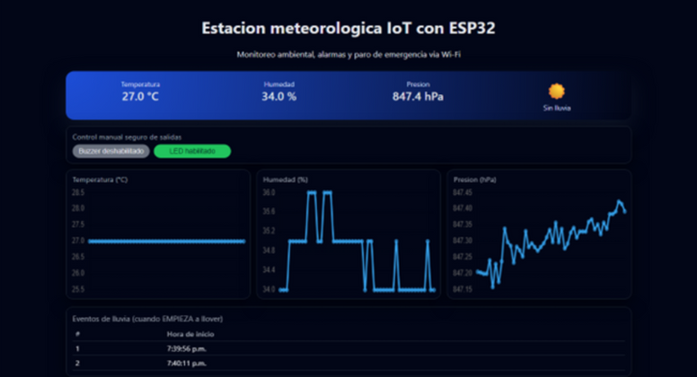
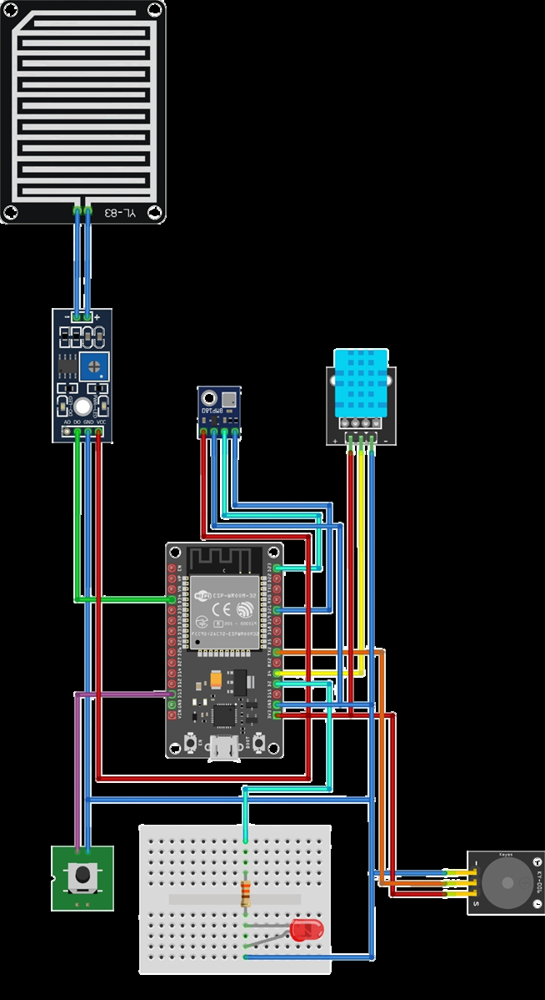
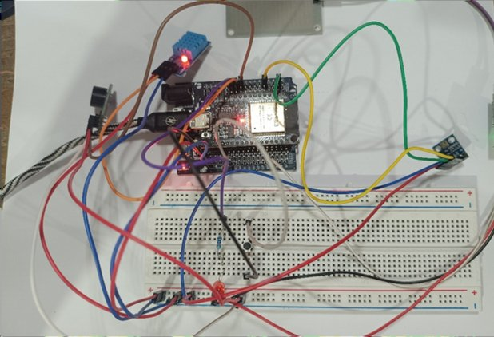

# Estación meteorológica con ESP32

Una estación del tamaño de un escritorio: un ESP32 con MicroPython lee temperatura, humedad,
presión y lluvia, y sirve un panel web en la red local con gráficas en vivo. Cuando empieza a
llover suenan un buzzer y un LED, que se pueden desactivar desde el panel o con un botón de paro.

Fue el proyecto final de Arquitectura de Computadoras (CUCEI, diciembre 2025) y mi primer
contacto con hardware. El servidor HTTP está escrito a mano sobre sockets, sin framework.



> La presión marca unos 847 hPa porque Guadalajara está a ~1,560 m sobre el nivel del mar.

## Qué hace

- Lee el DHT11 (temperatura y humedad), el BMP180 por I2C (presión) y el YL-38 (lluvia).
- Sirve `index.html` y un endpoint `/data` en JSON que el panel consulta cada 5 s.
- Grafica las últimas 50 lecturas con Chart.js y anota la hora en que empieza cada lluvia.
- `/control?buzzer=toggle` y `/control?led=toggle` habilitan o deshabilitan las alarmas.
- El botón de paro apaga buzzer y LED mientras esté presionado, sin importar lo demás.

## Material

| Pieza | Precio aprox. (MXN) |
|---|---|
| ESP32 DevKit | $100 |
| DHT11 | $30 |
| BMP180 | $23 |
| Sensor de lluvia YL-38 + placa YL-83 | $27 |
| Buzzer activo | $30 |
| LED, resistencia, botón | $10 |
| Protoboard y cables Dupont | $120 |
| **Total** | **~$340** |

## Conexiones

| Pieza | Pin del ESP32 |
|---|---|
| BMP180 SCL / SDA | GPIO 22 / GPIO 21 |
| DHT11 datos | GPIO 4 |
| YL-38 salida DO | GPIO 34 |
| Buzzer (activo en bajo) | GPIO 16 |
| LED | GPIO 2 |
| Botón de paro (a GND, pull-up interno) | GPIO 13 |

<p>
  
  
</p>

## Cómo correrlo

1. Flashea [MicroPython](https://micropython.org/download/ESP32_GENERIC/) en el ESP32.
2. Copia `config.example.py` como `config.py` y pon el nombre y contraseña de tu red.
3. Consigue un driver `bmp180.py` para MicroPython (por ejemplo el de
   [micropython-IMU](https://github.com/micropython-IMU/micropython-bmp180)); `dht` ya viene en el firmware.
4. Sube los archivos a la placa:

   ```bash
   mpremote cp main.py index.html config.py bmp180.py :
   mpremote reset
   ```

5. En la consola serie aparece la IP; ábrela desde un navegador en la misma red.

El panel carga Chart.js desde un CDN, así que el dispositivo que lo abre necesita internet.

## Limitaciones

- El DHT11 es poco preciso (±2 °C, pasos de 1 %).
- El sensor de lluvia también reacciona a la humedad del ambiente.
- No guarda histórico: lo que ves en las gráficas vive en el navegador.
- Es un prototipo en protoboard, sin carcasa.

## Créditos

Hardware, código y panel web: Victor Betancourt. Documentación del reporte: Celeste Sedano.
